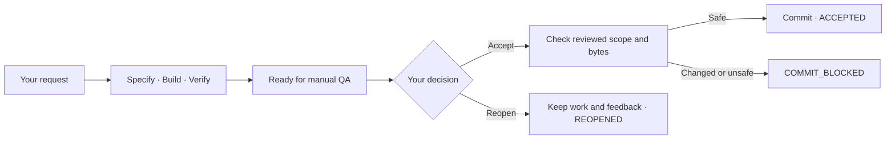

# Switchyard

### Let AI build. Keep the decision.

Turn a feature request or bug report into implemented, tested code—with a clear
path to review, acceptance and recovery.

Switchyard is a Python delivery engine for coding agents. It gives Claude, Codex
and deterministic tools defined jobs, explicit permissions and bounded execution.
It keeps the work, the evidence and the next step connected.

**Agents execute. Switchyard coordinates. You accept.**

[Get started](#see-it-work) · [Configure your project](docs/configuration.md) ·
[Integrate the engine](docs/design/v2-readiness.md) ·
[Resume and rollback](docs/design/delivery-recovery.md)

---

## A request becomes something you can review

A feature moves through specification, implementation and verification. A bugfix
adds reproduction and diagnosis. Each stage has a declared job and checked outputs.
The next stage receives the durable facts it needs.



Passing verification brings the work to `READY_FOR_MANUAL_QA`. You review it.
On acceptance, Switchyard checks that the repository still matches the candidate
presented for QA, then creates the commit deterministically. Changed content,
unexpected files or a moved base HEAD block the commit.

The final decision stays human. The final commit belongs to the control plane.

## Different agents. One deliberate workflow.

Choose an agent for each job. Use Claude for one stage, Codex for another, and a
real test command for verification. Configure escalation when a stage needs another
attempt at reasoning, within explicit limits.

Continuation carries a structured handoff. A fresh assessment excludes that prior
reasoning while keeping the declared factual artifacts. Requests, specifications,
evidence and handoffs live in durable workspaces; provider sessions never own the
workflow.

Permissions, timeouts and invocation budgets are explicit. Unsupported permission
combinations fail before provider invocation. Invalid outputs fail validation before
the invocation's artifacts or handoff are published.

## One file. Your choices.

Your normal configuration lives in **`.switchyard/config.yaml`**.
Agents, models, effort, permissions, timeouts, flows, verification and lifecycle
policy are editable together. Credentials stay in provider authentication or the
launch environment.

For example, this agent definition can serve every specification state:

```yaml
agents:
  spec:
    provider: codex
    model: gpt-6-astra
    effort: high
    workspace: read
    shell: true
    timeout: 600
```

Those states reference `agent: spec`. Change its provider and model here, and every
state using it follows. To change just one state, select a different named agent.

Inspect the result immediately, without calling a model:

```sh
switchyard config validate .switchyard/config.yaml
switchyard config show .switchyard/config.yaml
```

Start with the [complete FEATURE and BUGFIX configuration](examples/simple/config.yaml).
The [configuration guide](docs/configuration.md) explains each setting, including
command agents, escalation and budgets.

## A timeout has a next step

A provider can make useful changes and still time out. For deliveries started with
the recovery API, Switchyard records the interruption and checkpoints the partial
work after provider termination.

**Resume deliberately.** Increase the selected agent's timeout and resume the
interrupted stage. Completed stages stay completed. Work identity, artifacts,
handoffs and budget charges stay intact. Semantic configuration changes or
checkpoint drift block resume.

**Roll back precisely.** Discard an attempt by restoring its recorded pre-delivery
Git-visible state, including pre-existing dirty and untracked bytes. Later human
edits to delivery-owned paths block rollback. Accepted history stays protected.

**Keep the history.** Rollback retains artifacts, events, checkpoints and QA records.
Pending QA is permanently retired so it cannot later accept rolled-back work.

See the [recovery API and safety boundaries](docs/design/delivery-recovery.md).
Resume is explicit and requires remaining budget; there is no automatic retry.

## See it work

Use Python 3.10+ and Git. From a source checkout:

```sh
git clone https://github.com/Antonio-Ingegnere/switchyard.git
cd switchyard
python3 -m venv .venv
source .venv/bin/activate
python -m pip install .
```

Run a complete offline delivery and acceptance demonstration:

```sh
python -m examples.delivery.offline_lifecycle \
  --root /tmp/switchyard-accept-demo
```

It uses fake provider processes, a real test command and a disposable Git repository.
It delivers a change, reconstructs lifecycle state in another process, creates a QA
candidate and simulates the human's acceptance decision. It verifies that exactly
one commit contains the reviewed change and writes a `report.json`.

Try the reopen path separately:

```sh
python -m examples.delivery.offline_lifecycle \
  --root /tmp/switchyard-reopen-demo --operation reopen
```

Choose fresh, nonexistent directories for each demo. Results remain available for
inspection. **Neither command calls a live model or needs provider credentials.**
These temporary paths are for demonstrations; production work and QA require
persistent storage.

## Put it behind your product

Switchyard is an embeddable engine. Your application supplies the request, target
repository, project configuration and human decisions. Switchyard handles execution,
durable context, verification and the acceptance boundary.

The normal dependency is the installable `switchyard-runtime` package. Consumers can
pin a Git revision with ordinary pip requirements; a source-checkout environment
variable is unnecessary during normal execution.

| You need | Start here |
| --- | --- |
| Configure FEATURE or BUGFIX delivery | [One-file configuration](docs/configuration.md) |
| Embed execution and human QA | [Supported Python APIs](docs/design/v2-readiness.md) |
| Add explicit resume and rollback | [Recovery API](docs/design/delivery-recovery.md) |
| Understand artifacts and exact-scope acceptance | [Work and QA contracts](docs/design/work-contract.md) |
| Inspect cross-provider escalation | [Claude → Claude → Codex example](examples/escalation/workflows-v2.yaml) |
| Inspect the advanced workflow representation | [Workflow Bundle V2](docs/design/workflow-bundle-v2.md) |

Adeo consumes these APIs for feature delivery, bugfix delivery, manual QA and recovery.
Its product commands remain a thin layer over the engine.

## Proof you can inspect

Real provider runs have demonstrated [FEATURE delivery](docs/plans/v2-005-feature-dogfood.yaml),
[BUGFIX delivery and Claude → Claude → Codex escalation](docs/plans/v2-006-bugfix-dogfood.yaml).
The records retain failures and the corrections they led to.

Offline tests exercise the real compiler, runtime, provider protocols, workspaces,
command verification and Git lifecycle using fake providers and disposable repositories.
From the checkout, with dependencies installed:

```sh
TERM=dumb python -m unittest discover -s tests -v
```

The recorded RECOVERY-001 run contains **573 tests: 571 passed, one known local
synthetic SIGKILL failure and one platform skip**. The [recovery record](docs/plans/recovery-001.yaml)
documents the result. No live provider calls are required for the suite.

## Clear boundaries

Switchyard currently supports bounded, single-work-item delivery. Project/epic
planning, distributed scheduling and push/PR automation are outside this scope.

Recovery requires POSIX locking and cooperative worktree access. Ambiguous crash
state, incomplete publication and historical work without a recovery baseline may
require manual inspection. Ignored untracked files are outside Git-visible rollback.
Provider capabilities have explicit support limits, and successful provider
command-tool execution is not independently observed by the current adapters.

Read the [invariants](docs/design/v2-invariants.md),
[readiness and limitations](docs/design/v2-readiness.md) and
[recovery contract](docs/design/delivery-recovery.md) for the precise guarantees.
V1 and DELIVERY-001 compatibility remain supported. The [design records](docs/design/)
and [historical plans](docs/plans/) preserve the engineering history.

---

**A clear request. A bounded workflow. A human decision.**
